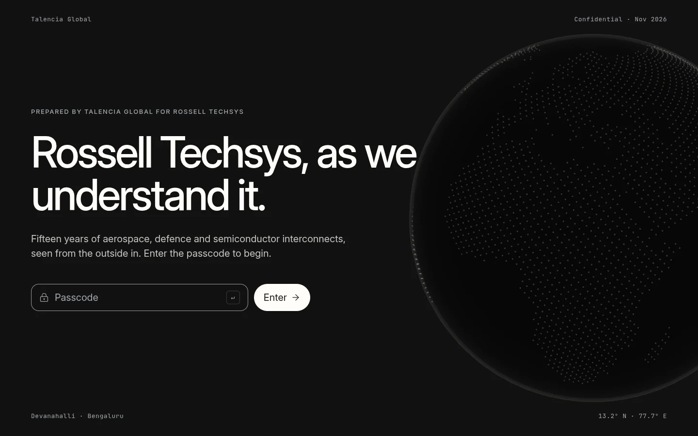
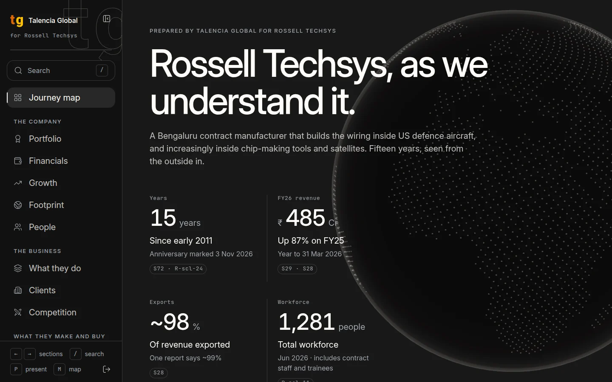
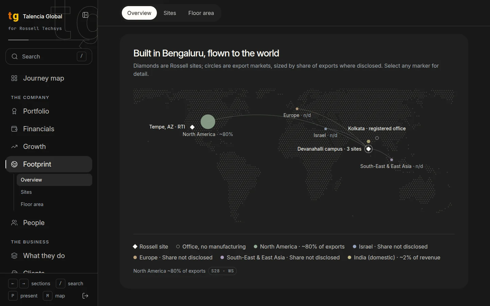
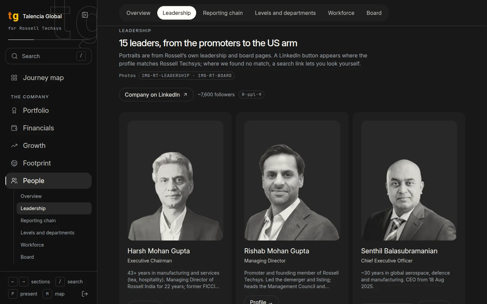

# Rossell Techsys, as we understand it

<p>
  
  
  
  
  
  
</p>

A private, passcode-gated, editorial website that walks through Rossell Techsys's company, business, products, supply base and operations, with every figure traced to a source.

## What it is

Talencia Global built this site for its new client Rossell Techsys, a Bengaluru contract manufacturer of wire harnesses and electrical wiring interconnection systems (EWIS) for aerospace, defence, semiconductor equipment and space. It shows how well we understand the company and its domain before the engagement starts. The site reads like an annual report rendered as software. It has five acts and fourteen chapters, each split into short sections with their own routes. Every number carries its source ids and a confidence label, so a reader can tell a public filing from a working-session note or our own estimate. Access is behind a shared passcode, and no page is indexed by search engines.

## Screenshots

<table>
  <tr>
    <th>Passcode gate</th>
    <th>Hub: title card with the globe</th>
  </tr>
  <tr>
    <td></td>
    <td></td>
  </tr>
  <tr>
    <th>Footprint: world map</th>
    <th>People: leadership</th>
  </tr>
  <tr>
    <td></td>
    <td></td>
  </tr>
</table>

## Features

- **Journey structure.** Act → Chapter → Section → Sub-section. Five acts hold fourteen chapters. Each chapter is a set of short sections, each on its own route (`/<chapter>/<section>`), with sticky section tabs, sub-section chips (`#anchor`) and previous and next doors. The last section of a chapter ends with "What this means", a plain-English takeaway.
- **Hub and journey map.** The home page opens on a title card with a 3D dotted globe and four headline figures, then the journey map: every act, every chapter door with its key figure and sections, and which doors you have already visited.
- **3D moments.** The globe on the hub, and in chapter 09 an exploded wire harness that assembles as you scroll. You can drag it to rotate and select any of its twelve parts to see what it is and what it does. Both use three.js through `@react-three/fiber`. A static fallback is shown where WebGL is not available.
- **Sourced facts with confidence labels.** Every figure shows citation chips (`S28 · R-scl-1`) that open the sources behind it. Anything other than a reported figure also carries a confidence tag (see [Content and sources model](#content-and-sources-model)).
- **Search.** `/` or `⌘K` (`Ctrl+K`) opens a command palette across chapters, sections, clients, people, suppliers, facts and sources. A result on another page navigates there and opens the matching detail.
- **Presenter mode.** `P` goes full screen, hides the rail and shows a slim `03 / 14 · 2/5` counter. Arrow keys step section by section.
- **Fact sheet.** `/factsheet` is a one-page summary of the key figures with their sources, styled for print. Use "Print or save as PDF".
- **Collapsible rail.** `[` collapses the desktop chapter rail to an icon strip and expands it again. The choice is remembered in `localStorage`.
- **Passcode gate.** Every page redirects to `/gate` until the visitor enters the shared passcode. A signed cookie keeps them in for 30 days.
- **Sign out.** The sign-out button at the foot of the rail clears the cookie and returns to the gate.
- **Responsive.** On phones the rail becomes a top bar with a menu sheet, and charts and tables reflow.
- **Reduced motion.** Entrance animations and smooth scrolling respect `prefers-reduced-motion`.

## Tech stack

| Area | Choice |
|---|---|
| Framework | Next.js 16 (App Router, `proxy.ts` for the gate), React 19, TypeScript 7 (`tsc`; the TypeScript 6 API package serves Next.js and typescript-eslint) |
| Styling | Tailwind CSS v4 with design tokens in `app/theme.css` |
| Components | shadcn/ui and Radix primitives restyled to the tokens, plus project primitives in `components/ui-rt/` |
| Motion | `motion` (Framer Motion) |
| 3D | `three`, `@react-three/fiber`, `@react-three/drei` |
| Charts and maps | `d3-scale`, `d3-shape`, `dotted-map` |
| Search | `cmdk` |
| Icons | `lucide-react` |
| Package manager | pnpm |

## Getting started

Requirements: Node.js 20 or later and pnpm 10.

```bash
pnpm install
cp .env.example .env.local     # then set SITE_PASSCODE in .env.local
pnpm dev                       # http://localhost:3000, redirects to /gate
```

Production build:

```bash
pnpm build && pnpm start
```

Other scripts: `pnpm lint`.

## Environment variables

| Variable | Required | Purpose |
|---|---|---|
| `SITE_PASSCODE` | Yes | The passcode visitors type on `/gate`. |
| `SITE_SECRET` | Recommended | Secret used to HMAC-sign the gate cookie. Falls back to `SITE_PASSCODE`. Generate one with `openssl rand -base64 32`. Changing it signs everyone out. |

How the gate works: `proxy.ts` (Next 16's renamed middleware) redirects every page to `/gate` unless the `rt_gate` cookie carries a valid HMAC-SHA256 signature (30-day lifetime). `/gate` posts to `/api/gate`, which compares the passcode with `SITE_PASSCODE` and signs the cookie with `SITE_SECRET`. `DELETE /api/gate` signs out. All pages send `robots: noindex, nofollow`.

## Routes

| Route | What it is |
|---|---|
| `/` | Hub: title card with the globe, then the journey map |
| `/<chapter>` | Redirects to the chapter's first section |
| `/<chapter>/<section>` | One focused section view: header (`02.3 / 14`), section tabs, sub-section chips, the section, previous and next doors |
| `/factsheet` | One-page printable fact sheet |
| `/gate` | Passcode gate |
| `/styleguide` | Design-system reference that renders every primitive |

Chapters, in order (`lib/journeyChapters.ts`):

| Act | Chapters |
|---|---|
| 01 The company | 01 `portfolio` · 02 `financials` · 03 `growth` · 04 `footprint` · 05 `people` |
| 02 The business | 06 `what-they-do` · 07 `clients` · 08 `competition` |
| 03 What they make and buy | 09 `anatomy` (finished goods and materials) · 10 `scale` · 11 `supply-base` |
| 04 How it runs | 12 `operations` · 13 `data` (files and data dictionary) |
| 05 Sources | 14 `sources` |

## Project structure

```
app/
  (journey)/              shared layout (rail, palette, keyboard), hub, [chapter]/[section], factsheet
  api/gate/               POST signs in, DELETE signs out
  gate/                   passcode page
  styleguide/             design-system reference
  theme.css               every design token (the only file with raw colour values)
components/
  journey/                ChapterShell, Section, ChapterRail, JourneyProvider, CommandPalette, FactSheet
  chapters/               one body per chapter; registry.tsx maps chapter ids to bodies
  ui-rt/                  design-system primitives (Stat, Cite, ConfidenceTag, ChartFrame, PhotoCard ...)
  ui/                     shadcn components restyled to the tokens
content/                  typed facts, people, clients, suppliers, files, sources
hooks/                    useKeyboardNav, useReducedMotionSafe
lib/
  journeyChapters.ts      acts and chapters (order, labels, hub-card copy, takeaways)
  structure/              sections and sub-sections, one file per chapter
  searchIndex.ts          palette item types and open-intent plumbing
  searchCatalog.ts        lazy-loads each chapter's search.ts
  gate.ts                 cookie signing and verification
public/images/            processed photos, client and organisation logos, leadership portraits
proxy.ts                  passcode gate
DesignStyle/DESIGN.md     design law
docs/                     research inputs and README screenshots
```

`lib/structure/<chapter>.ts` is the single source for a chapter's routes, rail entries, tabs, arrow-key order and search entries. To add a section, add it there and wrap the block in the chapter body with `<Section id="...">`.

Search: `lib/searchCatalog.ts` lazy-loads every chapter's `components/chapters/<folder>/search.ts`. Selecting an item on another page navigates to `/<chapter>/<section>?open=<type>:<id>`, and the chapter's `useSearchOpen` opens the detail overlay after mount.

## Content and sources model

All content lives in typed modules under `content/`. The contract is in `content/types.ts`: a `Fact` has a `value`, optional `label`, `unit`, `asOf` and `note`, a list of `sources` (source ids) and a `confidence`.

```ts
{ label: "Mar-26", asOf: "2026-03-31", value: 409.41, unit: CR,
  sources: ["S59", "R-scl-2"], confidence: "reported" }
```

Source ids:

- `S1`–`S92` follow Appendix B of `docs/Rossell_BOM_Supply_Chain_Research.md`.
- `R-<topic>-<n>` are later web research, one file per topic (`content/sources-<topic>.ts`).
- `WS`, `RULES`, `DECK-SC`, `DECK-RESEARCH` are internal inputs. `D-<slug>` are sources named only in the decks.
- `IMG-...` are photo, logo and portrait credits.

To add a fact:

1. Add the source to `content/sources.ts`, or to the right `content/sources-<topic>.ts`. For a new topic, create the file, export a `Source[]` and append it to `researchSourceLists` in `content/sources.ts`.
2. Add the fact to the relevant content module with its `sources` ids and a `confidence`.
3. Render it with the `ui-rt` primitives. `<Cite ids={...} />` shows the source chips and `<ConfidenceTag confidence={...} />` shows the label. The Sources chapter and the fact sheet pick sources up from `content/sources.ts` automatically.

Confidence labels (`components/ui-rt/ConfidenceTag.tsx`):

| Value | Label | Meaning |
|---|---|---|
| `reported` | Reported | Public filing or public report. No tag is shown by default. |
| `session` | Working session | From Rossell working sessions |
| `rules` | Internal rules | From the internal engineering and BOM business-rules draft |
| `calc` | Our calculation | Our arithmetic on sourced figures |
| `estimate` | Estimate | Our estimate, clearly labelled |
| `industry-example` | Industry example | Typical for the industry, not confirmed as Rossell's |

## Design system

The design law is `DesignStyle/DESIGN.md`. It describes a warm near-black, monochrome, editorial data UI in which numbers are the hero. Warm white is the only emphasis colour, and muted pastel `data-*` colours are reserved for data categories.

Rules that the code follows:

- `app/theme.css` is the only file with raw colour values. It wipes Tailwind's default palette, so only the tokens exist. Components use the generated utilities (`bg-surface`, `text-muted`, `bg-data-sage`) or CSS variables.
- No gradients, glows, drop shadows, pure black or pure white. The only exceptions are photo scrims and the selected-stat fade.
- `data-*` colours never appear on buttons, text or chrome. Colour is never the only carrier of meaning.
- Copy is plain, short and in sentence case, with no emoji or exclamation marks. Charts carry a one-line subtitle on how to read them.
- Shortcuts are shown next to the controls they trigger.

`/styleguide` renders every primitive with the tokens.

## Keyboard shortcuts

| Key | Action |
|---|---|
| `←` / `→` | Previous or next section, crossing chapter boundaries |
| `/` or `⌘K` / `Ctrl+K` | Open search |
| `Esc` | Leave presenter mode, otherwise back to the start |
| `[` | Collapse or expand the chapter rail |
| `P` | Presenter mode on or off |
| `Home` / `End` | First or last section |

Shortcuts are ignored while typing in a field or when a dialog is open.

## Deploying to Vercel

1. Import the repository in Vercel (framework preset: Next.js, package manager: pnpm).
2. Under Project → Settings → Environment Variables, add:
   - `SITE_PASSCODE`: the passcode you share with the client (required).
   - `SITE_SECRET`: a long random string, for example from `openssl rand -base64 32` (recommended).
3. Deploy. No custom server is used. Changing `SITE_SECRET` later signs everyone out.

## Notes on third-party imagery and logos

- **Photos.** The domain and programme photos in `public/images/` are public domain (US federal government works) or openly licensed (CC BY / CC BY-SA), mostly from Wikimedia Commons. We cropped them and toned them to the site palette. None shows Rossell's own facility or product, and captions say how each relates. Full credits and licences are listed in the Sources chapter (`content/assets.ts`, `content/sources-assets.ts`).
- **Logos and portraits.** Client and organisation logos, and the leadership portraits taken from Rossell's own leadership and board pages, belong to their owners. They appear only to identify those organisations and people on this private, passcode-protected site. Do not publish the site or these assets publicly without the owners' permission.

## Credits

Prepared by Talencia Global for Rossell Techsys · November 2026.
